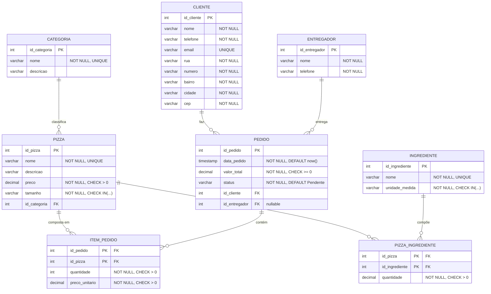

# Diagrama do Modelo Lógico — Pizzaria

> Diagrama renderizado em [Mermaid](https://mermaid.js.org/). Visualize em qualquer editor Markdown compatível (GitHub, VS Code com extensão Mermaid, etc.)

## Modelo Lógico (Diagrama ER Relacional)

## Cardinalidades

| Relacionamento | Card. | Descrição |
|---|---|---|
| Categoria → Pizza | 1 : N | Uma categoria classifica várias pizzas |
| Cliente → Pedido | 1 : N | Um cliente faz vários pedidos |
| Entregador → Pedido | 1 : N | Um entregador entrega vários pedidos |
| Pizza ↔ Ingrediente | N : M | Uma pizza tem vários ingredientes e vice-versa (via `pizza_ingrediente`) |
| Pedido ↔ Pizza | N : M | Um pedido contém várias pizzas e uma pizza aparece em vários pedidos (via `item_pedido`) |

## Mapeamento MER → Relacional

| Entidade/Relacionamento MER | Tabela Relacional | Tipo |
|---|---|---|
| Entidade Categoria | `categoria` | Tabela forte |
| Entidade Cliente | `cliente` | Tabela forte |
| Entidade Entregador | `entregador` | Tabela forte |
| Entidade Pizza | `pizza` | Tabela forte (FK → categoria) |
| Entidade Ingrediente | `ingrediente` | Tabela forte |
| Relacionamento Pizza-Ingrediente (N:M) | `pizza_ingrediente` | Tabela associativa |
| Entidade Pedido | `pedido` | Tabela forte (FK → cliente, entregador) |
| Relacionamento Pedido-Pizza (N:M) | `item_pedido` | Tabela associativa |
